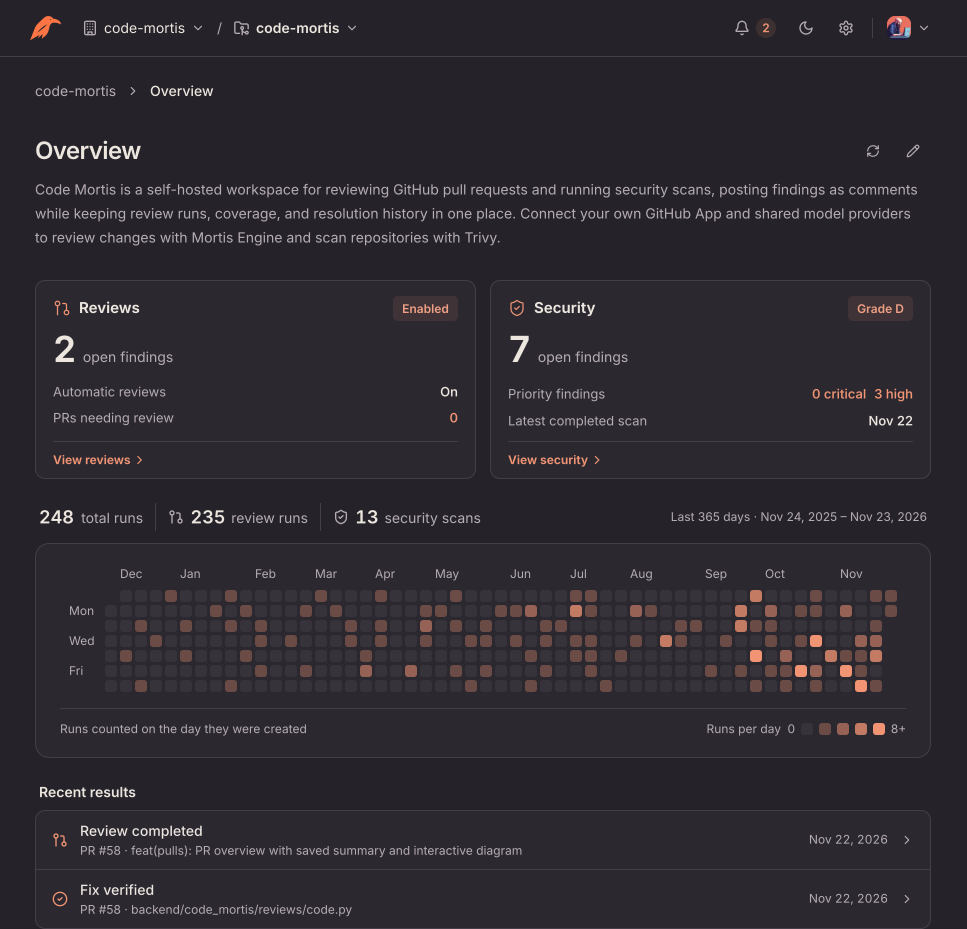

# Code Mortis

Self-hosted GitHub pull request reviews and repository security scans powered by [Mortis Engine](https://github.com/code-mortis/mortis-engine).



## Features

- Automatic and on-demand PR reviews with inline comments and GitHub checks from your own GitHub App. Incremental automatic reviews can reuse validated coverage for unchanged files.
- Repository security scans combining AI analysis with Trivy checks.
- Findings triage, run history, coverage, and model usage in one workspace.
- Shared model connections for OpenAI-compatible APIs, Anthropic, and Amazon Bedrock.
- Built-in code graph indexing for PR context and code navigation, enabled per repository in Settings.
- Scoped REST API tokens and MCP access for reviews, security, and indexed code. A [Noodle collection](collections/code-mortis/README.md) is included for the REST API.

## Develop locally

Use Docker Compose and Python 3.12+. Create a [Smee channel](https://smee.io/) to relay GitHub webhooks to your local stack.

```sh
python3 backend/code_mortis/manage.py init-env \
  --output .env.dev --owner YOUR_GITHUB_LOGIN \
  --url http://localhost:5173 --webhook-url https://smee.io/YOUR_CHANNEL

docker compose --env-file .env.dev -f compose.dev.yaml --profile webhooks up -d --build
```

Open [localhost:5173](http://localhost:5173), enter `CM_BOOTSTRAP_TOKEN` from `.env.dev`, and register a development GitHub App. The frontend and API reload on edit. Restart the affected worker or scheduler after changing its code.

The engine comparison, code graph benchmarks, and PR navigation benchmark live
in the companion `mortis-benchmarks` project, alongside their recorded results.

## Install from Docker Hub

Download `compose.yaml` and `manage.py` from the same [GitHub release](https://github.com/code-mortis/code-mortis/releases) and put them in one directory. The Compose file pulls the versioned [Code Mortis image on Docker Hub](https://hub.docker.com/r/codemortis/code-mortis/tags) for Linux `amd64` and `arm64`.

Use Docker Compose and Python 3.12 or newer. Point an HTTPS reverse proxy at `127.0.0.1:8080` and use its public origin when initializing the environment.

```sh
python3 manage.py init-env --owner YOUR_GITHUB_LOGIN --url https://reviews.example.com
docker compose pull
docker compose up -d --wait
```

Open the configured URL and enter `CM_BOOTSTRAP_TOKEN` from `.env`. Register and install your GitHub App, then add a shared AI connection. Code Graph ships in the image. Enable it in repository settings to start indexing. See the [deployment guide](https://codemortis.dev/docs/app/deployment/) for the full setup.

To move an existing source deployment to the release image, back up PostgreSQL and `CM_ENCRYPTION_KEY`. Replace `compose.yaml` and `manage.py` in the existing project directory, keeping its `.env` and volumes. Run `docker compose pull` followed by `docker compose up -d --wait --remove-orphans`. The migration service applies database upgrades, and `--remove-orphans` removes the retired graph containers.

## Deploy with Coolify

Point an HTTPS hostname at your Coolify server and run its Traefik proxy. Create a Git-based Docker Compose application with the repository root as the base directory and `/compose.yaml` as the Compose location. Enable **Raw** Compose deployment so the overlay provides the proxy labels. [Coolify Docker Compose guide](https://coolify.io/docs/applications/builds/docker-compose)

Generate the environment from a local checkout:

```sh
python3 backend/code_mortis/manage.py init-env \
  --owner YOUR_GITHUB_LOGIN --url https://reviews.example.com
```

Copy the generated `.env` values into Coolify’s **Environment Variables** and add `CM_PUBLIC_HOST=reviews.example.com`. Use the same hostname in both settings. Keep `.env` out of Git and back up `CM_ENCRYPTION_KEY` with your database backups.

Set **Custom Build Command** to:

```sh
docker compose -f compose.yaml -f compose.coolify.yaml build
```

Set **Custom Start Command** to:

```sh
docker compose -f compose.yaml -f compose.coolify.yaml up -d --remove-orphans
```

Deploy, then open your HTTPS URL and enter `CM_BOOTSTRAP_TOKEN`. Register and install your GitHub App on the repositories you want to connect, add a model connection, and enable reviews in repository settings.

## Publish a Docker image

The public image repository is `codemortis/code-mortis`. Set the GitHub Actions variable `DOCKERHUB_NAMESPACE` to `codemortis`, and configure `DOCKERHUB_USERNAME` and the `DOCKERHUB_TOKEN` secret with write access to the repository.

Add release notes under the matching version heading in `CHANGELOG.md`, such as `## 0.1.0`, then push a stable tag from `main`, such as `v0.1.0`. The workflow tests both Linux architectures, publishes the versioned Docker Hub image, and checks a fresh install. It then creates the GitHub Release with those notes and attaches `compose.yaml` and `manage.py`.

Licensed under [Apache 2.0](LICENSE).

[Sponsor Code Mortis on GitHub](https://github.com/sponsors/wilfredinni).
