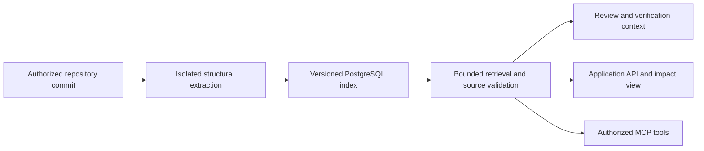

# Code graph: feature proposal and implementation plan

Status: **Phase 0 evaluation complete**, 2026-10-26; Phases 1–5 not started. See the [evaluation report and decisions](code-graph-phase0.md) and [recorded evidence](evidence/code-graph-phase0.json). No production indexer, graph API, MCP code tools, or graph UI has been implemented by this work.

This document preserves the investigation and follow-up decisions so development can resume without the original conversation. The user requested documentation for later development; this document does not authorize implementation, paid runs, deployment, commits, or pushes by itself. Read [AGENTS.md](../AGENTS.md), [PLAN.md](../PLAN.md), [PRODUCT.md](../PRODUCT.md), and the relevant source again before implementation.

## Purpose

Maintain a graph of a connected repository's code at an exact Git commit. Use it to find relevant source for reviews, expose useful code navigation to authorized external agents through MCP, and help users inspect the possible impact of a change.

The first benefit to establish is better cross-file review: finding unchanged callers affected by a change and discovering guards or definitions that rebut a false positive. The same retrieval implementation should serve workers, the application API, and MCP. A visual explorer is another consumer of that implementation.

## Decisions and clarifications to preserve

These preserve the discussion and subsequent Phase 0 decisions. The evaluation report defines the selected parser foundation, initial capability tiers, proposed operational limits and MCP placement. Production schemas and integration remain to be implemented and verified.

| Topic | Working direction |
| --- | --- |
| Embeddings | **Not required for this feature.** The initial implementation uses structural extraction, exact symbol/text search, and relationship traversal. No embedding model or embedding API is needed. |
| pgvector | Optional future semantic-search enhancement. Do not install or require it for the initial graph. Ordinary PostgreSQL tables can store symbols and edges. |
| Graph creation | Code Mortis builds and updates the graph on its own server using authorized repository access. Users do not upload a graph, install Graphify, or run indexing commands on their computers. |
| Graphify | Phase 0 compared pinned Graphify 0.9.37 with direct parsing. A false call marked `EXTRACTED` and missed alias calls rule out using its complete graph as authoritative evidence now. Select direct Tree-sitter parsing; Graphify remains local developer tooling. |
| Languages | Python and TypeScript/JavaScript were validation examples, **not a product language limit**. Phase 0 validated basic definitions across twelve languages and relative-file dependencies for Python/TS/JS. Resolved calls/references remain unvalidated for the selected baseline. Unsupported graph languages continue through the existing review workflow. |
| Activation | Start opt-in per repository, off for existing repositories and new installations. Proposed label: "Use code graph context". MCP source access needs separate explicit authorization. |
| Tokens | Parsing, storing, and querying the structural graph do not consume model tokens. Supplying retrieved source to a reviewer or MCP agent does consume input context and may increase total tokens. Savings are unproven. |
| Deployment target | Aim for a single developer on an 8 GB server with modest repositories and externally hosted review models. Phase 0 direct extraction passed under a 256 MiB container limit on two local source corpora. Full-stack concurrency/capacity remains unverified and belongs to Phase 2. |
| Priority | Establish useful internal retrieval first, then MCP access, then a focused visual impact explorer. |
| First storage choice | Reuse PostgreSQL and the existing job infrastructure. Do not introduce a dedicated graph database without measured need. |

Do not turn the discussion about local embedding models, vector dimensions, or embedding API charges into requirements. Those were explanations of an optional extension. Structural indexing still has CPU, memory, disk, and maintenance costs.

## What the initial feature includes

- Files, modules, definitions, imports, references, and resolved calls where the selected language adapter can support them.
- Directed, typed relationships with source locations and extraction/resolution provenance.
- Exact-name and text search; bounded caller, callee, import, and reference queries.
- Potential change impact based on a specified commit comparison or PR snapshot.
- Retrieval of actual source at the matching commit, with file and line citations.
- Visible language support, indexing status, missing relationships, exclusions, and response limits.

Examples:

| Question | Intended behavior |
| --- | --- |
| "What calls this function?" | Return supported call relationships with source locations; identify unresolved or partial results. |
| "Which code may be affected by this signature change?" | Find incoming references/callers and explain each connection. Impact means a candidate for inspection, not proof of breakage. |
| "Is validation already performed upstream?" | Retrieve relevant callers and guards for the reviewer to inspect against source. |
| "Which tests reference this symbol?" | Return references in test files; do not label them measured test coverage. |
| "What findings have occurred around this code?" | Combine with existing authorized finding history, preserving original occurrences and current status separately. |

Deferred: embedding-based semantic search, generated architecture documentation, a natural-language answering model, cross-repository graphs, runtime tracing, whole-program data-flow/taint analysis, automatic fixes, user-supplied graph imports, and unrestricted database query tools. Revisit each only for a concrete need. Graph structure alone cannot prove security exploitability, complete reachability, or that an unreferenced symbol is safe to delete.

## Current implementation baseline

Source inspected at commit `d8a09f12956bf074cdc9f5db868ecf04895eb812` on 2026-10-26. This is navigation for a future session; inspect current callers before editing.

| Area | Existing source and integration implication |
| --- | --- |
| Native review context | [reviews/delegated.py](../backend/code_mortis/reviews/delegated.py), `review()`, supplies the assigned file, diff, rules, background, and revisions. Candidate place to add bounded related source. Keep findings restricted to the assigned path. |
| OCR/API review path | [integrations/ocr.py](../backend/code_mortis/integrations/ocr.py), `review()`, invokes the pinned OCR engine. Verify its supported context contract before claiming parity with native-client enrichment. |
| Assessment and verification | [reviews/assessment.py](../backend/code_mortis/reviews/assessment.py) and [reviews/verification.py](../backend/code_mortis/reviews/verification.py), `build_context()`/`expand_context()`, already support additional source requests, exclusions, and evidence limits. Reuse this behavior. |
| Safe source/evidence handling | `verification.read_source()`, `filter_context()`, and [reviews/context.py](../backend/code_mortis/reviews/context.py) provide Git-object reads, sanitization, source identifiers, and citation validation. Preserve exact evidence and credential redaction. |
| Project background and diagrams | [reviews/background.py](../backend/code_mortis/reviews/background.py) generates a bounded background summary; [reviews/summary.py](../backend/code_mortis/reviews/summary.py) supports PR summary diagrams. Neither is an existing persistent structural graph. |
| Security | [security_scans/engine.py](../backend/code_mortis/security_scans/engine.py) has source inventory, protected-path rules, redaction, and requested evidence. Graph-assisted security context can reuse retrieval later without replacing scan coverage or verification. |
| Identity and repository access | [api/dependencies.py](../backend/code_mortis/api/dependencies.py), `repo_access()`, and [core/access.py](../backend/code_mortis/core/access.py) enforce selected repositories and current GitHub access. Installation identity alone is insufficient. |
| MCP | [mcp/auth.py](../backend/code_mortis/mcp/auth.py), [mcp/tools.py](../backend/code_mortis/mcp/tools.py), and [mcp/server.py](../backend/code_mortis/mcp/server.py) implement independent Reviews/Security resources, explicit tools, grants, consent, audit, and revocation. See [MCP plan](mcp-plan.md). No `code:read` scope currently exists. |
| API tokens | [api_tokens/policy.py](../backend/code_mortis/api_tokens/policy.py) explicitly controls bearer routes. Adding a browser graph API must not accidentally expose it under existing token permissions. See [route policy](api-token-route-policy.md). |
| Persistence and execution | [models.py](../backend/code_mortis/models.py), [jobs.py](../backend/code_mortis/jobs.py), and [backend architecture](architecture.md) define the existing domain, migration, and job patterns. Use additive migrations and durable job handling. |
| Runner isolation | [native_runner.py](../backend/code_mortis/native_runner.py) disables repository configuration discovery, shell execution, and MCP tools. The worker prepares graph context; the runner does not gain graph/database/GitHub access. |
| Deployment | [compose.yaml](../compose.yaml) runs PostgreSQL, Redis, API, several independent workers, scheduler, and native runner. Worker concurrency one does not prevent different workers from overlapping. Temporary filesystems consume memory as used; their configured maximum sizes are not reservations. |

The ignored `graphify-out/` directory is local developer tooling. Its schema, freshness, directionality, and inferred relationships must not be assumed suitable for production. Never load a PR's Graphify skill, instructions, or configuration as executable authority.

## Proposed architecture

### Extraction and storage

Phase 0 selected direct Tree-sitter parsing with conservative relative-file resolution. See the [capability matrix and rejected alternatives](code-graph-phase0.md). Syntax definitions and file dependencies form the initial tier; resolved symbol references/calls require additional validated language-aware work. SCIP is deferred. Do not enable repository execution to gain language coverage.

Use a small feature domain following [architecture.md](architecture.md), with shared Pydantic contracts and explicit route/tool adapters. Exact filenames and tables are to be finalized after the extractor evaluation; do not add a generic graph platform or provider abstraction in advance.

Minimum conceptual records:

| Record | Required information |
| --- | --- |
| Snapshot | Repository ID, immutable commit SHA, extractor/resolver versions, indexing-policy digest, build status, timestamps, supported/failed/excluded file counts, and bounded failure reasons. |
| File | Snapshot, relative path, Git blob/content hash, language, and extraction status. |
| Symbol | Snapshot/file, kind, name/qualified name, definition range, and an identity that distinguishes same-named symbols. A name alone is not a global identity. |
| Edge | Snapshot, source/target identities, direction, relationship type, source location, and provenance such as parsed, resolved, or heuristic. Preserve unresolved references without inventing targets. |

Preserve distinct edge types and both directions when applicable. Support cycles without unbounded traversal. Avoid duplicating entire repository contents in PostgreSQL initially; define how the source reader obtains the exact retained Git object after ephemeral review checkouts are removed. Source retrieval remains authorized and bounded.

A graph snapshot is scoped to one repository and revision. Phase 0 selected full bounded rebuilds initially. Later reuse of unchanged file artifacts must re-resolve affected relationships after imports, symbol definitions, renames, or deletions change; file hashes alone are insufficient. Never mix a current default-branch graph with a different PR head and present it as exact.

### Lifecycle and resource limits

- Enabling the repository feature schedules an initial index through durable work. Fetch only from the authorized repository; do not accept arbitrary clone URLs or filesystem paths.
- Refresh enabled default branches on relevant changes. For review enrichment, build or reuse the exact required PR revision; use base/head snapshots when the query needs both. Demand-driven PR indexes avoid indexing every inactive branch.
- Deduplicate jobs by repository, commit, extractor version, and policy. Publish completed snapshots atomically. A failed or interrupted build must not replace a usable snapshot or appear complete.
- Bound repository/file sizes, parsing time, process memory, traversal depth, result count, source bytes, and retained snapshots. Start with the [Phase 0 defaults](code-graph-phase0.md), distinguishing measured corpora from proposed admission ceilings; validate retrieval and database limits during implementation.
- Use one indexing job at a time initially. Isolate parser work with restricted resources, no repository scripts/hooks/builds, and no unnecessary network or credentials. Fetching and parsing have separate privilege needs; the native runner remains unchanged.
- Unsupported files, parse failures, unavailable objects, and unresolved references remain visible. Do not retry an unchanged failing revision indefinitely.
- Disabling the feature stops new graph work and graph use, cancels pending work safely, and preserves saved review evidence. Re-check activation and access at worker checkpoints. An uninstall or access revocation blocks later reads immediately even if cached data remains.
- Set a bounded cleanup policy for unreferenced snapshots before release. Never silently cascade graph cleanup into findings or immutable evidence. Explain backup, retention, restoration, and rebuild behavior in operations documentation.

## Internal review behavior

1. Resolve the exact run revision and effective exclusions before querying.
2. Find symbols intersecting changed code, then retrieve a small relevant neighborhood: definitions, imports, callers, and test references where supported.
3. Validate selected source paths/ranges against the exact Git objects, apply current authorization/exclusions and existing redaction, then assemble explicit context in the worker.
4. Keep assigned-file content, required evidence, source selection validation, and existing token/prompt limits intact. Optional graph context cannot silently displace required evidence or raise a budget.
5. Record the graph snapshot, selected source references, selection version, omissions, and whether enrichment was used, unavailable, unsupported, or limited. Retries of the same immutable run must remain reproducible.
6. If graph enrichment is unavailable, preserve the existing review path with an explicit context status. Missing evidence needed for a particular claim still means uncertain or withheld under existing rules. Missing graph data never means the code is clean.

Retrieving a related file is not reviewing it. Only validated assigned-file results contribute to review coverage. A graph connection, a missing edge, or absence from a later review cannot resolve a finding. No new model connection, provider fallback, or automatic token-budget increase is introduced.

Apply the shared retrieval first to the native review path, then assess the supported OCR/API integration and assessment/verification expansion. Record which paths are actually enriched. Do not advertise all-provider support based on one adapter or mocked tests. Security scanning is a later consumer of the same retrieval, subject to its independent evidence and permission rules.

## MCP and HTTP access proposal

Expose small typed read operations through the same authorized domain logic as the browser. The names below are proposals, not existing tools:

| Proposed tool | Inputs and result |
| --- | --- |
| `code_index_status` | Repository plus requested revision; indexed revision, readiness, supported languages, and partial/failed/excluded coverage. |
| `code_search` | Repository, revision, bounded name/text query, and pagination; matching files/symbols and source locations. No promise of embedding-based semantic search. |
| `code_get_symbol` | Repository, revision, symbol identity; definition and bounded source with citations. |
| `code_get_relations` | Repository, revision, symbol, relation type/direction, and limit; supported edges, provenance, and incompleteness. |
| `code_change_impact` | Repository and explicit commit comparison or PR identity; pinned base/head and bounded potentially affected code with an explanation for each connection. |

Every result identifies the resolved immutable commit, graph snapshot and extractor version, applicable coverage gaps, and truncation/pagination. Search or traversal limits must not look like exhaustive results. The server index does not contain an agent's uncommitted working-tree edits; clients compare revisions before applying the answer locally.

Phase 0 selected `code:read` on a separately activated `/mcp/code` resource, requiring separate browser consent and explicit repositories. Current server/domain schemas only support Reviews and Security, so Phase 3 requires deliberate backend, metadata, consent, settings, and client coverage. Endpoint placement must not silently widen old grants.

Read operations do not trigger paid inference or rebuilds. An absent index returns readiness information. Initially, indexing controls stay in the authorized browser configuration/job workflow; add an external execution tool only for a later explicit use case.

Enforce current GitHub access, selected repositories, active installation, activation, grant expiry/revocation, and scope on every call, including cached responses. Filter unauthorized or excluded material before traversal, ranking, pagination, and totals. Do not reveal its names through neighboring nodes or error messages. Source and derived text are untrusted data, never agent instructions. Keep sanitization and audit without logging source bodies or secrets.

Finding/history access retains the existing Reviews or Security authorization. Code read access does not imply access to security findings, other repositories, management operations, or model credentials. Do not enable new HTTP routes for existing personal API tokens by accident; either deny them initially or design an explicit new permission and consent contract.

## User interface proposal

Place the opt-in control and readiness status in the existing repository configuration, following [DESIGN.md](../DESIGN.md). Describe the cost honestly: indexing uses server resources and additional source context can increase review tokens. Display indexed revision, unsupported languages, and failures with a useful recovery action.

The first explorer should answer "what may this PR affect?": start with changed files/symbols, expand callers/dependencies on selection, and open exact source evidence. Provide a keyboard-accessible list/table equivalent, visible focus, readable labels, and explicit loading/empty/partial/error states. Keep results bounded and maintain filters/selection in the established navigation pattern. Avoid a whole-repository node cloud as the default view.

Link authorized findings and their immutable occurrences where useful, while displaying current resolution separately. Do not conflate graph coverage, review coverage, test references, and measured test coverage. A broader module-level repository map can follow only after the focused view proves useful.

## Implementation phases and completion gates

**Phase 0 is complete** with the linked report, fixtures and measurements. Phases 1–5 are **not started**. Mark later items complete only with linked evidence and update the handoff section after work.

### Phase 0: choose an extractor and establish feasibility

- [x] Compare pinned Graphify structural extraction with a direct parser/resolver alternative; inspect license, dependencies, process behavior, update semantics, and packaging. Consider SCIP only where it fits the no-repository-execution boundary.
- [x] Produce a language capability matrix separating parsing, definitions, imports, references, calls, and known unresolved cases. Validate Python and TS/JS examples without declaring them the final supported set.
- [x] Exercise aliases, re-exports, same-name symbols, cycles, decorators/dynamic calls, deleted targets, and unchanged callers affected by a changed definition. Mark uncertain relationships accurately.
- [x] Measure extraction time, peak memory including subprocesses, and graph size on recorded modest repositories. Run without embedding services, model credentials, repository scripts, or outbound parser access.
- [x] Decide the initial language/relationship set, isolation approach, memory/time caps, snapshot retention, and MCP resource placement. Record rejected options briefly with evidence.

Gate: a reproducible, bounded extraction demonstrates useful relationships and known gaps. If Graphify does not meet the gate, record why; do not adopt it merely because it is installed locally.

Gate met locally: [report](code-graph-phase0.md), [runnable assertions](../scripts/code_graph_eval/evaluate.py), [fixture corpus](../scripts/code_graph_eval/fixtures.json), and [twelve benchmark runs](evidence/code-graph-phase0.json). Select full bounded snapshot rebuilds and a separate `/mcp/code` resource with `code:read`; implementation remains in the later phases.

### Phase 1: persist snapshots and expose bounded retrieval internally

- [ ] Add minimal models/contracts and additive migrations; prove upgrade with existing review/history data intact.
- [ ] Implement authorized snapshot creation, reuse, atomic publication, cancellation/retry, and cleanup through existing durable job patterns.
- [ ] Implement exact symbol/text lookup, typed relationship traversal, impact candidates, and safe source retrieval with snapshot provenance and limits.
- [ ] Handle deletion, rename, parser/version/policy changes, concurrent jobs, worker restart, unavailable commits, partial parsing, and restricted paths.
- [ ] Add the repository opt-in/readiness control through the normal API and generated types; keep the feature off by default.

Gate: focused backend checks prove correctness, authorization, recovery, and bounded behavior. No new mandatory infrastructure for installations with the feature disabled; the optional isolated parser container has no database/Redis dependency or credentials. No embedding dependency. Disabled repositories keep their current behavior.

### Phase 2: integrate review context and measure quality/cost

- [ ] Integrate bounded retrieval into the native assigned-file review path without changing output scope or coverage accounting.
- [ ] Integrate supported OCR/API context and assessment/verification discovery through existing contracts; document any unsupported adapter explicitly.
- [ ] Save context provenance and explicit fallback/omission states, preserving exact required evidence, redaction, immutable retries, and current budgets.
- [ ] Compare current behavior, ordinary text/symbol retrieval, and graph-assisted retrieval on the same recorded historical PR corpus and model/configuration.
- [ ] Evaluate confirmed cross-file defects, false positives, source-citation accuracy, context expansion rounds, reported input/output tokens, and latency. Keep unknown usage unknown; count all inference rounds. Do not treat accepted comments alone as defect ground truth.
- [ ] Test the full stack under an 8 GB memory limit, including realistic overlapping review/security workloads, temporary files, database activity, and index updates. Record CPU, repository sizes, peak memory, failures, and disk growth.

Gate: measured benefit justifies cost against the simpler retrieval baseline, existing invariants pass, and resource behavior is documented. If enrichment does not help, retain the feature as experimental/opt-in and revise retrieval before broad rollout. Real provider runs and third-party source transfer require authorization for the specific evaluation.

### Phase 3: add external MCP access

- [ ] Implement the selected resource/scope design, explicit consent, default-off activation, repository selection, and tool discovery filtering without expanding existing grants.
- [ ] Add the typed tools above using shared retrieval and existing authorization/audit patterns. Keep responses bounded, revision-specific, and untrusted-content labeled.
- [ ] Test direct calls, cached results, old tool catalogs, cross-repository identities, excluded neighbors/counts, disabled settings/users/installations, expiry/revocation, and missing snapshots.
- [ ] Test that code access does not confer review/security history or personal API token access.
- [ ] Verify an authorized real external client: read index status, search, follow a relation, and inspect source at the expected commit. Record mocked transport checks separately.

Gate: current permissions hold across all result surfaces and a real client can navigate supported code without model execution or writes.

### Phase 4: add the focused impact explorer

- [ ] Add PR impact navigation and source links using the existing design system and shared read API.
- [ ] Include an accessible list/table representation, keyboard interaction, responsive behavior, and truthful partial/stale/unsupported states.
- [ ] Link findings only under their existing domain permissions and preserve historical/current distinctions.
- [ ] Validate browser behavior with mocked production-build tests, then separately verify one authorized real repository and PR snapshot.

Gate: a user can trace a change to its supporting relationships and source evidence without relying on a visual-only interaction or an unbounded graph.

### Phase 5: release and operational readiness

- [ ] Document initial build, updates, status recovery, resource limits, retention, backups/restoration, cancellation, and disable/rebuild behavior in [operations.md](operations.md).
- [ ] Update [PRODUCT.md](../PRODUCT.md), [DESIGN.md](../DESIGN.md), public docs, and [acceptance.md](acceptance.md) only to reflect delivered behavior and actual evidence.
- [ ] Complete required backend/frontend checks, OpenAPI/type regeneration, migration checks, relevant token-route/collection contract checks, and hosted CI for the final change. Refresh the local development Graphify graph separately.
- [ ] Confirm turning the feature off restores existing context behavior without deleting review history or widening access. Record measured deployment requirements and remaining limitations.

Gate: opt-in rollout is reviewable, recoverable, and supported by local, hosted, and real-account evidence identified separately. Publication/deployment remains a separate authorized action.

## Open decisions

1. Which additional definition/import forms and symbol resolvers meet the same accuracy gates beyond the Phase 0 matrix?
2. Do the selected admission, parser and retention limits fit the full stack under the 8 GB target, including database/storage growth and overlapping work?
3. How should the selected optional parser container's bounded worker transport and dedicated internal network be implemented and tested? Initial snapshots rebuild fully; artifact sharing/incremental invalidation is deferred.
4. What exact OCR/API context integration is available in the pinned engine?
5. How should the selected independent `/mcp/code` resource extend discovery, settings, domain types, consent and redaction without widening existing grants?
6. Which benchmark cases and quality/cost thresholds justify release? Establish these before claiming improvements.

Embeddings, pgvector, and generated documentation are not open blockers for the initial feature. Reconsider them only after structural retrieval is evaluated.

## Research references

Reviewed during the 2026-10-25/26 discussion. These describe vendor capabilities or candidate technology, not independently measured Code Mortis results. Recheck before making current product comparisons.

- [Greptile graph-based context](https://www.greptile.com/docs/how-greptile-works/graph-based-codebase-context): structural relationships used for review retrieval.
- [Greptile MCP tools](https://www.greptile.com/docs/mcp-v2/tools): knowledge-base listing, reading, and search; documentation describes organization rollout and synthesized documents, not arbitrary raw-graph traversal.
- [CodeRabbit context engineering](https://www.coderabbit.ai/blog/context-engineering-ai-code-reviews) and [MCP connections](https://docs.coderabbit.ai/connections/mcp-servers): dependency context internally; the referenced MCP integration describes CodeRabbit as a client of external servers.
- [Qodo Software Map](https://www.qodo.ai/features/software-map/) and [context engine](https://www.qodo.ai/blog/introducing-qodo-aware-deep-codebase-intelligence-for-enterprise-development/): user-facing impact maps and agent access are useful product references.
- [Sourcegraph MCP](https://sourcegraph.com/docs/api/mcp) and [precise navigation/SCIP](https://sourcegraph.com/docs/code-navigation/precise-code-navigation): examples of revision-aware symbol/navigation tools and semantic indexing.
- [Graphify](https://github.com/Graphify-Labs/graphify), [Tree-sitter](https://tree-sitter.github.io/tree-sitter/), and [pgvector](https://github.com/pgvector/pgvector): extraction candidate, syntax parsing foundation, and optional future vector search respectively.

## Handoff for the next session

Completed locally: investigation, this plan, and **Phase 0**. Read [code-graph-phase0.md](code-graph-phase0.md) for the extractor decision, twelve-language capability tiers, adversarial/revision checks, measured corpora, operational defaults and MCP resource choice. Direct Tree-sitter parsing is selected; Graphify 0.9.37's complete graph is rejected as authoritative evidence for now. No embeddings or pgvector.

Local additions: `scripts/code_graph_eval/`, the evaluation report, and `docs/evidence/code-graph-phase0.json`; PLAN.md links the result. Commands and immutable corpus commits are in the report. Both fixture suites and twelve bounded benchmark runs passed; Ruff passed. Dependencies are pinned only in the evaluation image. No production dependency, migration, review/model run, external MCP integration, full-stack 8 GB test, hosted CI, deployment, commit or push was performed.

Next useful work: **Phase 1**, beginning with exact-revision snapshot/file/symbol/dependency contracts and additive persistence, followed by authorized isolated indexing and bounded internal retrieval. Implement the selected capability tiers honestly: file dependencies are not resolved calls. Full rebuilds precede incremental caching. Keep the feature off by default and preserve the current native runner boundary.

Suggested resume request:

> Read AGENTS.md, PLAN.md, docs/code-graph-plan.md, and docs/code-graph-phase0.md. Resume Phase 1 of the optional structural code graph feature using the Phase 0 decisions and fixtures. Preserve the no-embeddings, opt-in, exact-revision and isolated-parser boundaries. Do not advertise unresolved calls as authoritative relationships. Update the plan with actual validation and the next handoff.

After each development session, update this section with the exact completed phase/items, relevant commit or local diff, commands/results, real versus mocked evidence, unresolved decisions, and the next concrete task. Keep unfinished checkboxes open. Never infer deployment, performance, or language support from the existence of this plan.
